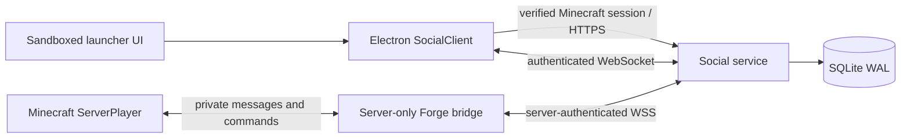

# Usagi Social

Status: implemented locally, with protocol, GUI and Forge tests. **Not deployed or
verified with two authenticated Minecraft players.** Minecraft application approval
still blocks official launcher account sign-in. No production identity bypass exists.

## Components and identity

- services/social: Node 24 service, SQLite database, HTTP sessions and WebSockets.
- src/main/social: trusted launcher client; no session token enters the renderer.
- src/renderer/pages/Social.tsx: friends, requests, conversations and privacy.
- integrations/forge: Java 17 / Forge 47.4.28 server integration; no client mod needed.

The backend verifies official Minecraft Java entitlements and the profile before
creating a launcher session. It ignores/rejects client-supplied UUID fields. The
server-only bridge supplies UUIDs and names from an online-mode Minecraft server;
the same verified UUID resolves to the same Social account in both paths. Minecraft
name updates preserve the account and history. A separate, unique Usagi username is
editable in Privacy; the linked Minecraft identity remains unchanged.

No public registration/password service or general chat system was added. With
Minecraft API approval pending, production launcher Social authentication remains
unavailable. The test identity verifier is a dependency supplied only by isolated
test tools, not an environment switch, desktop setting or production endpoint.

## Features

Search registered players by exact Usagi username or their latest verified Minecraft
name. Players become known after verified launcher login or a trusted server join.
Send/accept/decline/cancel requests, remove friends, block/unblock users, and set
discovery, incoming-request, visibility and notification preferences. The current
limits are 250 relationships/requests, 1,000 blocks and 1,000 characters per message.

Private messages require an accepted friendship and no block in either direction.
History, unread counters, offline delivery and preferences persist. History is paged
50 messages at a time. Presence combines launcher and game connections, expires
after 65 seconds without a heartbeat, and honors invisible mode. Playing status
comes from the trusted Celestia bridge, never a launcher-provided status flag.

The launcher reconnects with bounded exponential backoff, replays durable inbox
messages and merges by message ID. Disconnecting/changing accounts clears Social
state and revokes the current service session. Backend sessions store only token
hashes and expire after 24 hours. A launcher restart obtains a new service session
through its protected official Minecraft account; no Social token is written to disk.

## Backend deployment

Use one Node **24.21.x** service process with a persistent local disk. SQLite is a
single-owner deployment here, not a multi-replica database. GitHub Pages and Vercel
static hosting cannot run it. A small Linux VM with a TLS reverse proxy is sufficient
for initial deployment; load-test your player count before a public release.

1. On the build machine, run npm ci, then npm run build:social.
2. Copy services/social/{dist,package.json,package-lock.json,WS-LICENSE.txt} to a
   dedicated server directory such as /opt/usagi-social. The supplied backend bundle
   contains these files. Install with npm ci --omit=dev --ignore-scripts there.
3. Provision a private data directory owned only by the service account.
4. Configure these environment variables through your host's secret/config store:

| Variable | Value |
| --- | --- |
| USAGI_SOCIAL_DB | /var/lib/usagi-social/social.sqlite or another persistent absolute path |
| USAGI_BRIDGE_SECRET | Random 32–200 character secret, shared ONLY with the Forge server |
| HOST | 127.0.0.1 behind the reverse proxy |
| PORT | 8787 |

Generate a secret locally with a cryptographic generator, for example Node's
crypto.randomBytes(32).toString('base64url'). Do not paste it into chat, source,
config/usagi.json, a client modpack or a public launch script. The app-update signing
key is unrelated and must not be reused as this secret.

5. Start node dist/main.cjs. GET http://127.0.0.1:8787/health must return
   {"ok":true,"protocol":1}. The service refuses to start without a valid bridge key.
6. Configure a real DNS name and HTTPS/WSS proxy to port 8787. The supplied
   Caddyfile.example and usagi-social.service.example show the layout. Replace
   social.example.invalid, provision /etc/usagi-social/environment privately and
   adjust the Node executable path before enabling the unit. Never expose port 8787
   directly over unencrypted public HTTP. Allow HTTP loopback only for local tests.
7. Set config/usagi.json social.baseUrl to the actual HTTPS **origin**, without a
   path/query, then rebuild the launcher. Its default is blank, with an honest
   unconfigured screen. There is no fabricated production Social URL.

The API uses /v1/session (POST/DELETE), /v1/realtime (WebSocket) and /health. Browser
origins are rejected; the Electron main process and server bridge are the callers.
The proxy must pass WebSocket upgrades. Do not log Authorization headers, session
request bodies or WebSocket frames. Do not cache these routes.

For local startup, set USAGI_BRIDGE_SECRET in your terminal, choose an absolute
USAGI_SOCIAL_DB, run npm run build:social, then node services/social/dist/main.cjs.
Health checks work without Minecraft approval; real account creation still needs it.

## Forge installation

Build/install instructions and all Minecraft commands are in
[integrations/forge/README.md](../integrations/forge/README.md). The same backend
secret is configured only in the server's environment. Keep online-mode=true. The
bridge refuses offline-mode identities, including unsupported offline-mode proxies.
Do not distribute the secret to players. No Prism or live server was modified.

## Delivery and recovery

Messages commit to SQLite before acknowledgment. Sender request IDs are unique per
sender; a retry returns the existing message and conflicting reuse is rejected.
Delivery acknowledgments are checked against the recipient. Read state is separate
from delivery, and a block/removal suppresses queued delivery in both directions.

The bridge persists recent message IDs in the world's data/usagi-social-receipts.json
before acknowledging them to the backend, suppressing normal reconnect/restart
replays. It sends only ServerPlayer.sendSystemMessage; /usagi commands never
broadcast success or message bodies to global chat. Conversations can be read with
/usagi inbox <player>; this marks the displayed range read.

Exactly-once display cannot be guaranteed across a crash between Minecraft showing
a chat message and writing the receipt. Delivery is at least once at that boundary;
the original message ID remains stable. The receipt cache retains 10,000 IDs.
Desktop notifications can also repeat after a crash before server acknowledgment.
No end-to-end encryption is claimed: the trusted backend stores message text.

Back up SQLite with SQLite's backup API or stop the service and copy the database
with its WAL/SHM files. Never copy only an active SQLite main file and assume the
WAL is included. Back up world receipt data with the Minecraft world. Restrict
database, backup and environment-file access; use disk encryption on shared hosts.
Keep the same bridge secret across ordinary restarts and rotate it on both hosts
when needed. One active bridge is supported per backend deployment.

## Live two-player acceptance plan

1. Obtain Minecraft API approval for Usagi, deploy HTTPS/WSS and install the server
   bridge on a backed-up staging server with online-mode=true.
2. Sign Alpha into the real launcher; join that server as Beta from an independent,
   authenticated Minecraft client. Alpha must not launch Minecraft.
3. Send a request to Beta in Social. In-game, use /usagi friends and
   /usagi friends accept Alpha. Verify both see the accepted relationship.
4. Send Alpha → Beta. Check only Beta receives [Usagi DM], then use
   /usagi reply to answer. Verify Alpha's conversation updates immediately.
5. Send /usagi msg Alpha <text> and confirm the reverse direction independently.
   A third player must receive neither message nor command output.
6. Disconnect Beta, send more messages, restart the service/server, reconnect Beta
   and verify queued messages and acknowledgments. Repeat a reconnect: no normal
   duplicate delivery. Read /usagi inbox Alpha and verify unread counters.
7. Test both directions of block, removed friendship, private search, invisible
   status, notifications off, rate limits, abrupt network loss and account switching.
8. Restart both launchers and the server and compare UUID links/history/preferences.
   Do not approve a public operational claim until this entire live flow passes.
